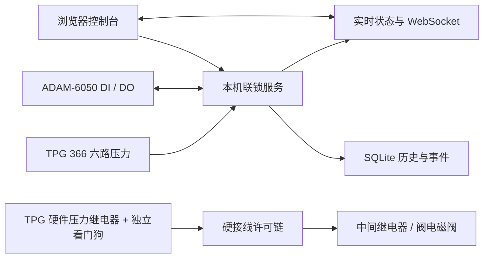

# 真空联锁控制台

用于 TPG 366 真空规控制器与 HTC GVBB-SS-CF63-P 插板阀的本地监控和联锁演示程序。提供实时压力、通道阈值、关阀/人工复位流程、SQLite 历史数据、CSV 导出和事件审计；前端采用暗色液态玻璃面板，布局参考 [beam-stabilizer-live-control](https://github.com/dcysbb/beam-stabilizer-live-control)，玻璃效果为本项目独立实现。

> **现场安全边界：** 本项目不是经过功能安全认证的安全仪表系统。软件轮询、操作系统、网络、ADAM-6050 或其输出发生故障时，不能单独保证阀门关闭。真实使用前必须由有资质的人员把 TPG 366 压力继电器、独立硬件看门狗和阀门电磁阀组成断线趋于关阀的硬接线许可链，并用实际阀/线圈验证失电动作、气源故障、传感器极性和关阀时间。ADAM-6050 输出只驱动合适的中间继电器，不能直接驱动阀线圈。真实联锁默认禁用，不能把示例阈值当作设备设定值。

## 快速开始

开发和首次演示需要 Python 3.11+、Node.js 22+ 与 npm。后端默认以模拟模式运行，不会连接真实设备。

在 Windows PowerShell 从仓库目录运行：

```powershell
npm --prefix frontend ci
npm --prefix frontend run build
py -3.12 -m venv backend\.venv
backend\.venv\Scripts\python -m pip install -r backend\requirements.txt
Push-Location backend
.\.venv\Scripts\python run.py
Pop-Location
```

服务启动后访问 <http://127.0.0.1:8770>。首次在本机浏览器打开时，设置至少 12 位的操作员密码。模拟状态下可以启用联锁、模拟开阀、注入压力超限并验证锁存关阀和人工复位。

`py -3.12` 创建虚拟环境后，后续启动只需在仓库根目录执行：

```powershell
Push-Location backend
.\.venv\Scripts\python run.py
Pop-Location
```

macOS/Linux 开发环境可在 `backend` 中用 `python3 -m venv .venv`、`.venv/bin/python -m pip install -r requirements.txt` 和 `.venv/bin/python run.py` 启动。前端开发服务器使用 `npm --prefix frontend run dev`，端口 5173 会代理 API 和 WebSocket 到本机后端。

## 配置真实设备

1. 在总览页先设置操作员密码并登录，进入“设备与系统设置”。
2. 选择“真实设备”，填写 TPG 366 的 IP/TCP 端口（默认 8000）和 ADAM-6050 的 IP/Modbus TCP 端口（默认 502）。控制器需位于受控实验室网络。
3. 只为确定需要保护的 TPG 通道启用保护，并填入实验室批准的关阀压力和较低的恢复压力。界面单位可选 Pa、mbar、Torr，存储值统一为 Pa。任一已启用通道达到关阀值即锁存触发；所有保护通道都低于恢复值并稳定一段时间后，才允许人工复位。
4. 按现场接线填写 ADAM DI/DO 通道及有效电平。现场核对阀门传感器的数量、常开/常闭、安装位置和开/关方向；默认极性按“不许可”处理，不应在未测量输入的情况下直接切换。
5. 保存配置，点击“连接并校验”。程序连接 TPG 366 与 ADAM-6050，并把启用通道的压力回差写入 TPG 继电器后逐路读回。设备离线或设定值读回不符时，不能启用联锁。
6. 完成下一节列出的硬件验收后，在真实硬件确认卡片勾选确认并输入“现场确认”，再手动启用联锁。启用前需要压力读数新鲜、阀门关闭位置有效、硬件许可和独立看门狗反馈均正常。

### 设备映射

| 设备信号 | 软件默认映射 | 现场要求 |
| --- | --- | --- |
| TPG 366 压力通道 | CH1–CH6，保护通道按配置启用 | TPG 必须输出压力单位；电压单位会被拒绝；状态非正常或样本超时会撤销许可 |
| ADAM DI0–DI11 | 阀关闭、阀打开（可选）、压力许可、看门狗反馈、锁存反馈、气源（可选） | Modbus 读输入功能码 02，地址 00001–00012 对应 DI0–DI11；输入极性按实测填写 |
| ADAM DO0–DO5 | DO0 开阀请求、DO1 心跳、DO2 复位 | Modbus 线圈地址 00017–00022 对应 DO0–DO5；输出为低电流开集电极，必须经过隔离/中间继电器 |
| 插板阀位置 | 关闭 DI 必填，打开 DI 可选 | 必须把传感器实际位置与 ADAM 输入一一对应；开/关反馈冲突或动作超时会进入故障锁存 |

阀门具体断电状态取决于随货的电磁阀、气路和弹簧复位结构。仅凭 `GVBB-SS-CF63-P + Sensor` 型号描述无法确认现场线圈的失电位置，也不能假定 Sensor 一定提供两路独立行程反馈。

## 运行状态和数据



后端负责采样、阈值比较、联锁状态机、阀门请求输出和事件记录；浏览器只显示状态和提交经身份验证的操作。状态包括“未启用、联锁已启用、联锁已触发、故障停机”。保护触发后阀门保持关阀请求，不自动重开；压力恢复后仍需操作员人工复位，复位后阀门继续关闭。配置变化会撤销运行许可并留下事件记录。

历史页可按时间和通道筛选、查看曲线与最近采样行。页面预览最多返回 100,000 行并显示截断提示；CSV 通过独立只读数据库连接分批导出完整查询范围。数据和事件保存在本机 SQLite；设置 `VACUUM_INTERLOCK_DATA_DIR` 可改变默认数据目录（Windows 默认 `%PROGRAMDATA%\VacuumInterlock`，macOS/Linux 默认 `~/.local/share/vacuum-interlock`）。可在设置页配置历史保留天数，未填写时不自动清理。

## Windows 打包

确认 `frontend/dist` 已由 `npm run build` 生成后，从仓库根目录运行：

```powershell
./scripts/build-windows.ps1
```

脚本会创建 `backend/.venv-build`、安装打包依赖并生成 `backend/dist/VacuumInterlock/` 文件夹。把整个文件夹复制到运行主机，双击 `VacuumInterlock.exe` 启动服务，然后在运行主机浏览器打开 <http://127.0.0.1:8770>。此版本以前台进程运行；如需开机启动，可由现场管理员配置 Windows 任务计划程序，并确认服务账户对数据目录有写权限。

局域网访问默认关闭。开启后需重启后台；服务会生成本机自签 HTTPS 证书，其他工作站必须先通过受控流程信任该证书。请限制实验室网段访问并定期轮换操作员密码。切勿把设备控制端口直接暴露到互联网。

## 接口与验证

主要接口：`GET /api/status`、`GET /api/config`、`PUT /api/config`、`GET /api/history`、`GET /api/events`、`GET /api/history/export.csv`、`WS /ws/status`。首次密码设置与操作员登录使用 `/api/auth/setup` 和 `/api/auth/login`；真实控制操作需要登录会话。

本机运行测试：

```powershell
backend\.venv\Scripts\python -m pip install -r backend\requirements-dev.txt
Push-Location backend
.\.venv\Scripts\python -m pytest tests -q
Pop-Location
npm --prefix frontend run build
```

驱动协议和模拟联锁有自动化测试，但尚未连接真实 TPG 366、ADAM-6050、阀门、电磁阀或线圈进行硬件验收。软件测试通过不代表真实保护链验证通过。
